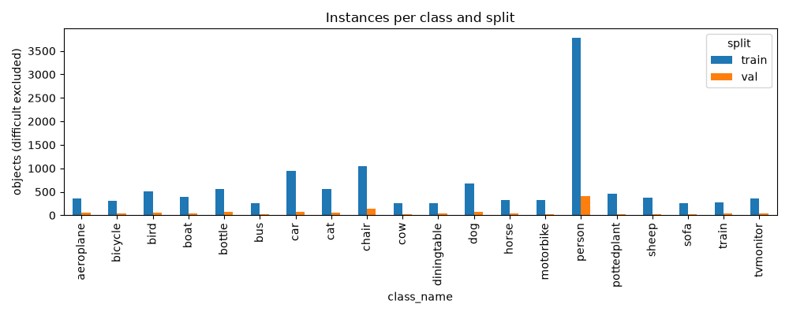
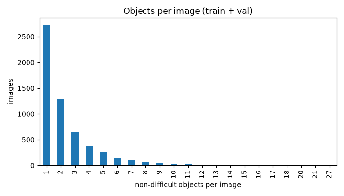
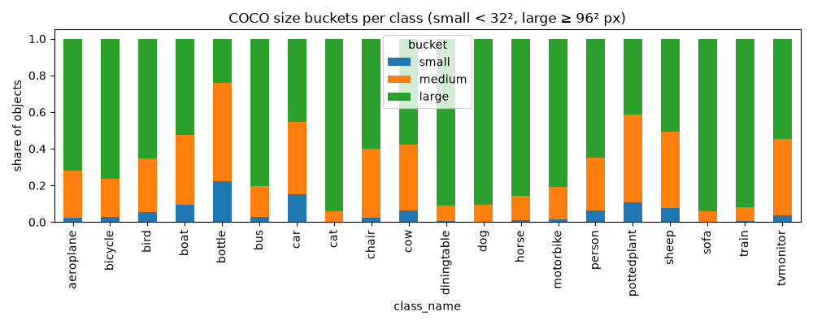
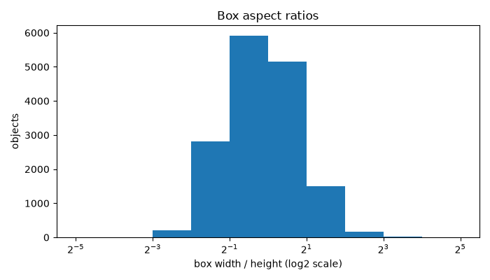
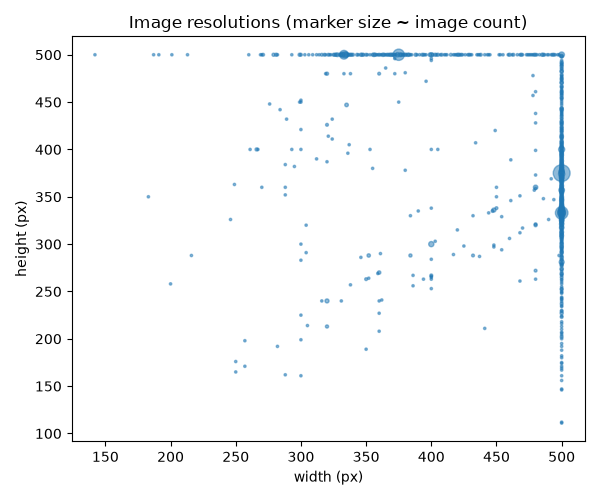
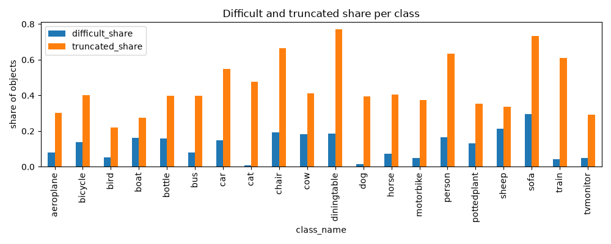
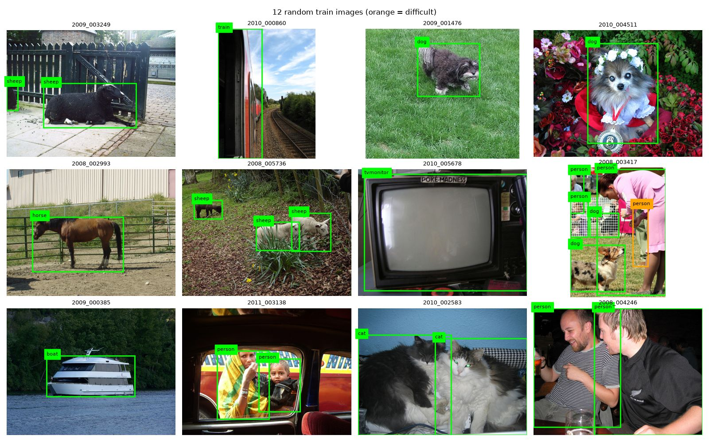

# Exploratory data analysis

_Generated by `src/vocdet/data/eda.py` from `results/eda/`. Do not edit by hand._

Statistics cover the **train** and **val** splits only. The test split (official VOC2012 val) is
not inspected before Phase 5; only its image count is shown.

## Overview

| Split | Images | Objects (non-difficult) |
|---|---|---|
| train | 5145 | 12277 |
| val | 572 | 1332 |
| test | 5823 | not inspected |

## Findings that affect modelling

1. **Class imbalance.** `person` is 30.8% of training objects; the most frequent
   class has 14.7x the objects of the rarest (`sofa`). Expect per-class AP to
   vary widely, so report per-class AP, not only the mean.
2. **Small objects.** 6.0% of objects are COCO-small (< 32² px). The classes with the
   highest small-object share are `bottle`, `car`, `pottedplant`. Expect AP_small to be the weakest bucket and
   these classes to have more misses; input resolution matters most for them.
3. **Few objects per image.** The median image has 2 non-difficult objects,
   47.7% of images contain exactly one, and the maximum is 27. The default
   `max_det=100` is far above what any image needs.
4. **Difficult and truncated.** 13.7% of objects are marked difficult (excluded from
   training, ignore regions in evaluation) and 51.4% are truncated.
   0 train/val images contain only difficult objects and act as background-only
   images.
5. **Resolution.** Images are at most 500x500 px (544 distinct sizes). YOLO at
   640 px and Faster R-CNN with a 600 px short side (1000 px cap) therefore only ever upsample: no
   image detail is thrown away by the input size, and lower YOLO input sizes (Phase 6 sweep) are
   the first point where detail is lost.
6. **Aspect ratios.** 90% of boxes have width/height between 0.32 and 2.64. The
   tallest classes by median box shape are `bottle`, `person`, `chair`; the widest are `aeroplane`, `boat`, `diningtable`. The detector must
   cover a wide range of box shapes.

## Tables

### Instances per class (difficult excluded)

| class_name   |    train |     val |   share_train |
|:-------------|---------:|--------:|--------------:|
| aeroplane    |  367.000 |  65.000 |         0.030 |
| bicycle      |  310.000 |  43.000 |         0.025 |
| bird         |  503.000 |  57.000 |         0.041 |
| boat         |  384.000 |  42.000 |         0.031 |
| bottle       |  553.000 |  76.000 |         0.045 |
| bus          |  262.000 |  30.000 |         0.021 |
| car          |  938.000 |  75.000 |         0.076 |
| cat          |  553.000 |  52.000 |         0.045 |
| chair        | 1045.000 | 133.000 |         0.085 |
| cow          |  265.000 |  25.000 |         0.022 |
| diningtable  |  258.000 |  46.000 |         0.021 |
| dog          |  684.000 |  72.000 |         0.056 |
| horse        |  318.000 |  32.000 |         0.026 |
| motorbike    |  328.000 |  29.000 |         0.027 |
| person       | 3786.000 | 408.000 |         0.308 |
| pottedplant  |  453.000 |  31.000 |         0.037 |
| sheep        |  375.000 |  25.000 |         0.031 |
| sofa         |  257.000 |  24.000 |         0.021 |
| train        |  279.000 |  34.000 |         0.023 |
| tvmonitor    |  359.000 |  33.000 |         0.029 |

### Size buckets per class

| class_name   |   small |   medium |    large |   small_share |
|:-------------|--------:|---------:|---------:|--------------:|
| aeroplane    |  11.000 |  111.000 |  310.000 |         0.025 |
| bicycle      |  10.000 |   73.000 |  270.000 |         0.028 |
| bird         |  31.000 |  164.000 |  365.000 |         0.055 |
| boat         |  41.000 |  162.000 |  223.000 |         0.096 |
| bottle       | 141.000 |  337.000 |  151.000 |         0.224 |
| bus          |   8.000 |   49.000 |  235.000 |         0.027 |
| car          | 153.000 |  400.000 |  460.000 |         0.151 |
| cat          |   0.000 |   36.000 |  569.000 |         0.000 |
| chair        |  27.000 |  447.000 |  704.000 |         0.023 |
| cow          |  18.000 |  104.000 |  168.000 |         0.062 |
| diningtable  |   2.000 |   26.000 |  276.000 |         0.007 |
| dog          |   2.000 |   68.000 |  686.000 |         0.003 |
| horse        |   4.000 |   46.000 |  300.000 |         0.011 |
| motorbike    |   5.000 |   64.000 |  288.000 |         0.014 |
| person       | 265.000 | 1209.000 | 2720.000 |         0.063 |
| pottedplant  |  53.000 |  230.000 |  201.000 |         0.110 |
| sheep        |  31.000 |  166.000 |  203.000 |         0.077 |
| sofa         |   0.000 |   17.000 |  264.000 |         0.000 |
| train        |   2.000 |   23.000 |  288.000 |         0.006 |
| tvmonitor    |  14.000 |  163.000 |  215.000 |         0.036 |

### Difficult and truncated share per class

| class_name   |   difficult_share |   truncated_share |
|:-------------|------------------:|------------------:|
| aeroplane    |             0.081 |             0.302 |
| bicycle      |             0.139 |             0.400 |
| bird         |             0.054 |             0.220 |
| boat         |             0.161 |             0.274 |
| bottle       |             0.160 |             0.399 |
| bus          |             0.079 |             0.397 |
| car          |             0.149 |             0.547 |
| cat          |             0.007 |             0.476 |
| chair        |             0.191 |             0.664 |
| cow          |             0.183 |             0.411 |
| diningtable  |             0.185 |             0.772 |
| dog          |             0.016 |             0.393 |
| horse        |             0.072 |             0.406 |
| motorbike    |             0.048 |             0.373 |
| person       |             0.164 |             0.634 |
| pottedplant  |             0.131 |             0.354 |
| sheep        |             0.214 |             0.336 |
| sofa         |             0.296 |             0.734 |
| train        |             0.043 |             0.609 |
| tvmonitor    |             0.049 |             0.294 |

## Figures

